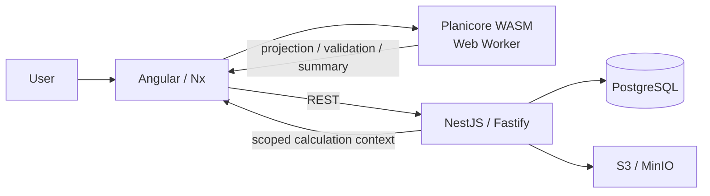
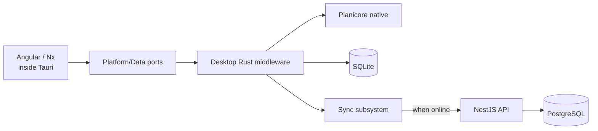
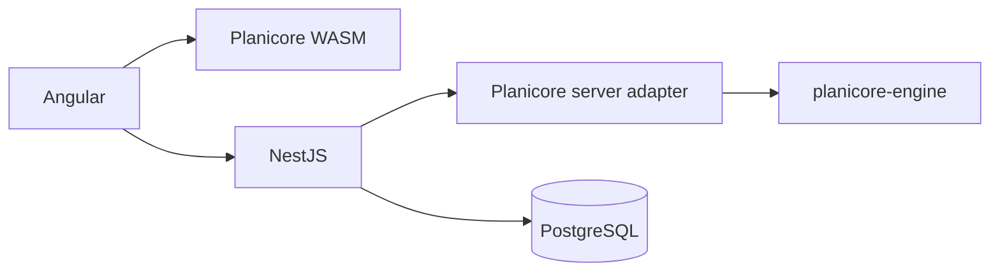

# Architecture overview

- **Architecture revision:** 12 October 2026
- **Architecture baseline:** V1
- **Calculation engine:** Planicore

This overview, [Planicore](planicore.md), and [Cloud trust and verification](cloud-trust.md) form the engineering source of truth for system architecture. Future targets are identified separately from V1 decisions.

## Purpose and scope

Planicam supports cloud and desktop deployment contexts within one product architecture:

- **Cloud web application:** Angular + NestJS + Planicore/WASM + PostgreSQL.
- **Desktop target:** the same Angular frontend inside Tauri, with native Rust services, Planicore, SQLite, and offline synchronization.

This document covers core principles, logic ownership, the technology stack, and runtime architecture. See [product context](../product-context.md) for the domain and [engineering policy](../engineering-policy.md) for decision criteria.

## Core architectural principles

These rules override local implementation convenience.

### One implementation of domain calculations

Any calculation or deterministic domain rule that must behave identically across cloud and desktop belongs in **Planicore**.

Do not independently implement the same geometry, topology, compatibility, pricing, or technical calculation in Angular, NestJS, and Rust.

### Angular owns interaction, not engineering truth

Angular owns:

- UI composition;
- editor interaction;
- routing;
- selection;
- viewport state;
- zoom/pan;
- transient drag state;
- guidelines that do not affect geometry;
- forms and presentation;
- orchestration of API and Planicore calls.

Angular must not become a second geometry or rules engine.

### Planicore is pure

`planicore-engine` contains only deterministic domain computation.

It must not contain:

- database drivers;
- HTTP/network calls;
- filesystem I/O;
- Tauri APIs;
- browser APIs;
- NestJS concepts;
- process management;
- organization/session authorization;
- persistent caches.

Inputs in, outputs out.

### NestJS is the cloud authority for security and persistence

NestJS owns:

- authentication;
- authorization;
- organization/tenant isolation;
- catalog visibility and licensing policy;
- API validation;
- persistence;
- optimistic concurrency;
- server-only workflows;
- cloud-only business logic;
- security-sensitive entitlements.

In V1 it does **not** independently recalculate Planicore output.

### Angular is ignorant of persistent data source

Feature code should not care whether persistent data comes from:

- NestJS/PostgreSQL in cloud mode; or
- the desktop Rust middleware/SQLite in offline mode.

Platform-specific behavior stays behind adapters.

### Platform detection is local and deterministic

Desktop detection must not depend on a network request.

Use Tauri's injected runtime global:

```ts
const isTauri = '__TAURI_INTERNALS__' in window;
```

The concrete check belongs in `platform/runtime`; feature libraries do not access the global directly.

### Canonical input and derived output are separate

A Position is persisted as canonical engineering input/state plus derived calculation summaries.

Derived data must remain reproducible from canonical input and a compatible Planicore/catalog version.

### Correct boundaries are preferred over short-term duplication

V1 may defer infrastructure, but not by duplicating domain logic across languages.

## Logic placement

Use these categories by default. If Mehrdad has a specific reason to deviate, explain the tradeoff.

| Logic category                           | Home                                                            |
| ---------------------------------------- | --------------------------------------------------------------- |
| Online-only, shared by cloud and desktop | NestJS                                                          |
| Desktop-only synchronization             | Desktop Rust middleware                                         |
| Cloud-only                               | Its natural single home                                         |
| Shared and offline-capable               | Planicore; only this category belongs in the shared Rust engine |

## Technology stack

| Layer                       | Technology                              | V1 / Architecture Role                                                      |
| --------------------------- | --------------------------------------- | --------------------------------------------------------------------------- |
| Cloud UI                    | Angular                                 | Main browser UI                                                             |
| Frontend workspace          | Nx                                      | Domain-oriented libraries and dependency boundaries                         |
| UI component system         | PrimeNG                                 | Component foundation and shared design system                               |
| Cloud calculation runtime   | Rust → WebAssembly                      | Planicore compiled to WASM and executed in a Web Worker                     |
| Desktop shell               | Tauri                                   | Later V1 desktop wrapper around the same Angular application                |
| Desktop calculation runtime | Native Rust                             | Planicore compiled natively and invoked through desktop Rust infrastructure |
| Backend                     | NestJS + Fastify                        | Modular monolith, REST API; microservices rejected for V1                   |
| Cloud database              | PostgreSQL                              | One PostgreSQL database                                                     |
| Desktop database            | SQLite                                  | Offline mirror/local project storage                                        |
| Calculation contracts       | Protobuf + `buf`                        | Shared calculation message source of truth for TypeScript and Rust          |
| Tauri/Rust command typing   | Generated bindings where applicable     | Prevent manually duplicated desktop IPC types                               |
| Object storage              | S3 / MinIO                              | Catalog snapshots, DXF archives, generated documents, avatars               |
| Internal backend events     | NestJS EventEmitter behind an interface | In-process messaging while backend remains a monolith                       |

An OpenAPI-generated Angular REST client is rejected for V1.

## Overall runtime architecture

### Cloud V1

The browser executes Planicore locally. NestJS handles persistence and security.



Critical consequence:

> **There is no cloud server-side Planicore execution in V1.**

The browser calculates geometry and other Planicore-owned derived results. NestJS persists the canonical Position document and the client-calculated summary after validating the request envelope and access rules.

### Desktop target architecture

Desktop is not implemented in Phase 2, but the frontend must remain compatible with this target.



Angular feature code uses the same domain-facing interfaces. The desktop runtime provides alternative adapters.

### Future server verification architecture

A native server adapter is a future hardening layer, not a V1 dependency.



When introduced, NestJS can reconstruct a trusted calculation input and independently run Planicore before accepting authoritative derived commercial/technical output.

See [Cloud trust and verification](cloud-trust.md) for V1 validation limits and the deferred server IPC strategy.
